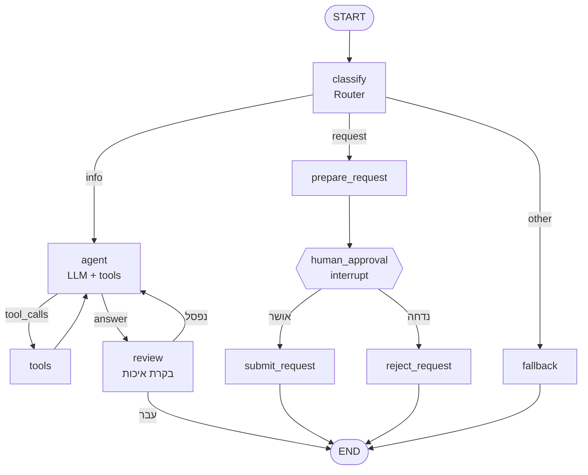
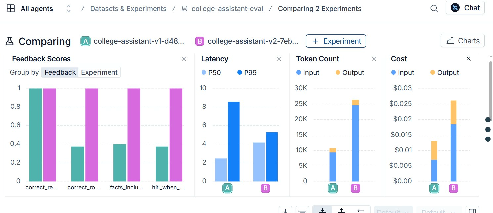
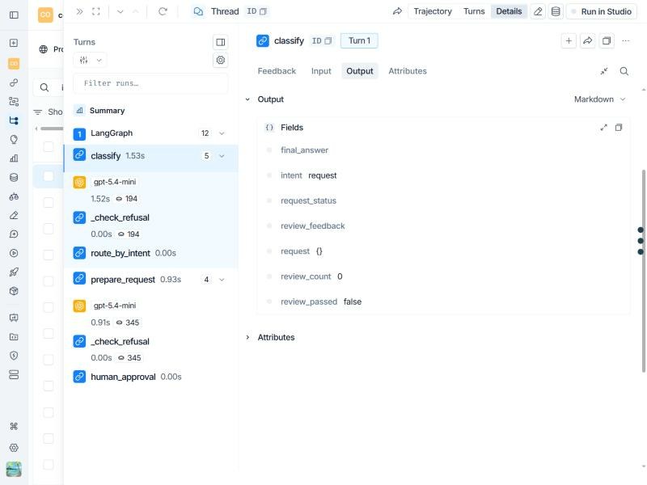
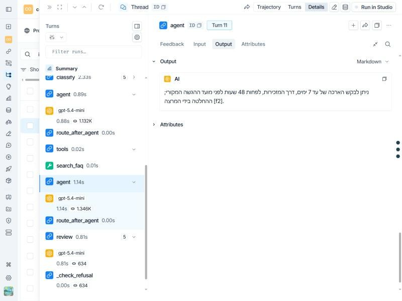

# עוזר מזכירות למכללה – LangGraph Agent

Agent שעונה לסטודנטים על שאלות לגבי נהלים וקורסים, ומגיש בקשות למזכירות (הארכה, ערעור, אישור לימודים, היעדרות). לפני שבקשה מוגשת, אדם צריך לאשר אותה.

## מבנה הגרף



הגרף משלב כמה Agent Patterns מהשיעור:

| Pattern | איפה בקוד |
|---|---|
| **Router** | `classify` מסווג את ההודעה ל-info / request / other, ו-Conditional Edge שולח לענף המתאים |
| **ReAct** | לולאה בין `agent` ל-`tools`: המודל מחליט אם להפעיל כלי, מסתכל על התוצאה וממשיך |
| **Reflection / Review** | `review` בודק שהתשובה מבוססת על מה שהכלים החזירו; אם לא, מחזיר ל-`agent` עם הערות (עד 2 סבבים) |
| **Human-in-the-loop** | `human_approval` קורא ל-`interrupt()`. הגרף נעצר עד שאדם מאשר, דוחה או מתקן, וממשיך עם `Command(resume=...)` |

## עמידה בדרישות

| דרישה | מימוש |
|---|---|
| ספריית LangGraph | `agent/graph.py` – `StateGraph`, `ToolNode`, `interrupt`, `Command` |
| לולאה או ענף מותנה | שתי לולאות (ReAct ו-review) ושלושה Conditional Edges |
| interrupt ו-HITL | `human_approval` – אישור / דחייה / עריכה לפני הגשת בקשה |
| דאטהסט והערכה ב-LangSmith | `eval/dataset.py` (16 דוגמאות), `eval/evaluators.py` (4 מעריכים), `eval/run_eval.py` |
| ניסוי לפני ואחרי שיפור | אותו גרף עם פרומפטים `v1` (בסיס) ו-`v2` (משופר), ב-`agent/prompts.py` |
| README עם trace ותובנה | בהמשך הקובץ |

## מבנה הפרויקט

```
agent/
  graph.py      – הגרף: Nodes, Edges, interrupt
  state.py      – ה-State המשותף
  tools.py      – הכלים: search_faq, get_course_info, והגשת בקשה
  prompts.py    – פרומפטים בגרסאות v1 ו-v2
  llm.py        – בחירת המודל
data/
  faq.json      – תקנון ושאלות נפוצות (מכללה דמיונית)
  courses.json  – פרטי קורסים
eval/
  run_all.py    – כל ההערכה בפקודה אחת (דאטהסט, v1, v2, טבלה ב-README)
  dataset.py    – יצירת הדאטהסט ב-LangSmith
  evaluators.py – המעריכים
  run_eval.py   – הרצת ניסוי
ui.py           – ממשק צ'אט בדפדפן (Streamlit) עם אישור אנושי
app.py          – צ'אט בטרמינל עם אישור אנושי
langgraph.json  – הגדרה ל-LangGraph Studio
```

## התקנה

```bash
python -m venv .venv
.venv\Scripts\activate          # Windows
pip install -r requirements.txt
copy .env.example .env          # ולמלא מפתחות
```

צריך מפתח API למודל (ברירת המחדל: OpenAI ‏gpt-5.4-mini; נתמך גם Gemini) ומפתח LangSmith מ-smith.langchain.com.

## הרצה

**ממשק בדפדפן (מומלץ):**
```bash
streamlit run ui.py
```
נפתח חלון צ'אט בדפדפן. בקשות מציגות כרטיס "נדרש אישור" עם כפתורי אישור/דחייה ואפשרות לתקן את התיאור.

**צ'אט בטרמינל:**
```bash
python app.py
```
דוגמאות לנסות:
- `מתי הבחינה בבסיסי נתונים?` – ענף info, הפעלת כלי
- `אני רוצה הארכה של יומיים בתרגיל בפייתון` – ענף request, הגרף ייעצר ויבקש אישור
- `ספר לי בדיחה` – ענף other

**LangGraph Studio (לצילום הגרף):**
```bash
pip install "langgraph-cli[inmem]"
langgraph dev
```

## הערכה ב-LangSmith

הכול בפקודה אחת: יצירת הדאטהסט, ניסוי v1, ניסוי v2, ומילוי טבלת התוצאות כאן ב-README:
```bash
python -m eval.run_all
```
(אפשר גם צעד-צעד: `python -m eval.dataset`, ואז `python -m eval.run_eval --version v1` ו-`--version v2`.)

בזמן ההערכה אין אדם, ולכן `run_eval.py` מאשר בקשות אוטומטית, אבל רושם אם הייתה עצירה (`hitl_triggered`), כדי לבדוק שה-interrupt קורה רק כשצריך.

**המעריכים:**

| מעריך | מה בודק |
|---|---|
| `correct_route` | הנתב שלח לענף הנכון |
| `facts_included` | העובדות הנדרשות מופיעות בתשובה (שאלות מידע) |
| `hitl_when_needed` | אישור אנושי הופעל אם ורק אם זו בקשה |
| `correct_request_type` | סוג הבקשה חולץ נכון |

**מה שונה בין v1 ל-v2:**
- **Router:** ב-v1 רק שמות הקטגוריות. ב-v2 הגדרה לכל קטגוריה, כלל מפורש לשאלות "איך מבקשים..." (זה מידע, לא בקשה), ודוגמאות few-shot.
- **Agent:** ב-v1 "ענה לסטודנט". ב-v2 חובה להפעיל כלי, לענות רק לפי מה שהכלים החזירו, משפט קבוע כשאין מידע, וציון הסעיף.

### תוצאות

| מעריך | v1 | v2 |
|---|---|---|
| correct_route | 0.38 | 1.00 |
| facts_included | 0.40 | 1.00 |
| hitl_when_needed | 0.38 | 1.00 |
| correct_request_type | 1.00 | 1.00 |

ניסויים ב-LangSmith: `college-assistant-v1-d4875342` מול `college-assistant-v2-7eb3c7af` (ציון ממוצע בין 0 ל-1).

**ניתוח התוצאות** (לפי הניסויים ולפי הקובץ `output/requests.jsonl`, שבו נרשמת כל בקשה שהוגשה):

- **ב-v1 הנתב שלח כמעט הכול לענף הבקשות.** מתוך 16 הדוגמאות, 14 הגיעו ל-`request` ו"הוגשו" למזכירות. ביניהן 8 שאלות מידע, ואפילו "מה מזג האוויר מחר בירושלים?" ו"תכתוב לי שיר על חתולים". רק 2 שאלות מידע עברו בענף הנכון. לכן `correct_route` ו-`hitl_when_needed` יצאו 0.38 (6 מתוך 16), והגרף עצר לאישור אנושי ב-10 מקרים מיותרים.
- **`correct_request_type` יצא 1.00 בשתי הגרסאות**, כי כל 4 הבקשות האמיתיות הגיעו לענף הנכון גם ב-v1. הבעיה ב-v1 היא לא שהוא מפספס בקשות, אלא שהוא רואה בקשה בכל דבר.
- **ב-v2 כל 16 הדוגמאות נותבו נכון**, וכל העובדות הנדרשות הופיעו בתשובות.
- **המחיר של השיפור:** לפי הגרפים ב-LangSmith, v2 צרך בערך פי 2.5 טוקנים (כ-25 אלף לעומת כ-10 אלף), עלה בערך פי 2 (כ-0.026$ לעומת כ-0.013$ לכל הדאטהסט), וזמן התגובה החציוני עלה מכ-2.5 לכ-4 שניות. זה לא אומר ש-v1 יעיל יותר. הוא "חסך" כי עצר ב-interrupt במקום לחפש בכלים ולענות. התשובות הנכונות של v2 עולות יותר, אבל הן היחידות ששוות משהו.
- **תובנה על המעריך עצמו:** ב-v1 יצא `facts_included` = 0.40, למרות שרק 2 שאלות מידע קיבלו תשובה אמיתית (שתיהן בציון מלא, 2 מתוך 10). שתי הנקודות הנוספות הגיעו בטעות: בשאלה "תוך כמה זמן אפשר לערער?" מספר הבקשה שנוצר היה `F14627`, והוא מכיל "14". בשאלה על אישור לימודים מספר הבקשה `FEF431` מכיל "3". המעריך בדק רק אם המחרוזת מופיעה בתשובה, ולכן נתן ציון על התאמה מקרית. שיפור אפשרי: לבדוק עובדות רק כשהשאלה הגיעה לענף המידע, או לבדוק מספרים כמילה שלמה.



## צילומי Trace

**v1 – השאלה "איך מבקשים הארכה?" נשלחה בטעות לענף הבקשות ועצרה ב-interrupt:**


**v2 – אותה שאלה עברה בענף המידע: agent ← tools ← agent ← review:**


## תובנה מה-Traces

### התובנה המרכזית: הנתב ב-v1 נאחז במילים ולא בכוונה

הרצתי את אותה שאלה, **"איך מבקשים הארכה להגשת מטלה?"**, פעם עם v2 ופעם עם v1, והשוויתי את שני ה-traces ב-LangSmith:

| | v1 | v2 |
|---|---|---|
| סיווג של `classify` | `request` ❌ | `info` ✅ |
| מסלול בגרף | `prepare_request` ← `human_approval` (עצירה לאישור) | `agent` ← `tools` ← `agent` ← `review` |
| תוצאה | הגרף עצר וביקש לאשר "בקשת הארכה" שאף אחד לא ביקש | "ניתן לבקש הארכה של עד 7 ימים, דרך המזכירות, לפחות 48 שעות לפני מועד ההגשה" |
| זמן / טוקנים | 2.47 שניות, 539 טוקנים | 5.23 שניות, 3,523 טוקנים |

**מה ראיתי:** ב-trace של v1 הריצה הסתיימה כבר אחרי `classify` ו-`prepare_request`, ונעצרה ב-interrupt. השאלה סווגה כבקשה, כי הופיעו בה המילים "מבקשים" ו"הארכה".

**למה זה קרה:** בפרומפט של v1 יש רק שמות של קטגוריות (`info, request, other`) בלי הגדרה. המודל לא יודע שההבדל הוא בין *לשאול על נוהל* לבין *לבקש שיבצעו פעולה*, ולכן הוא מסווג לפי מילים.

**מה שיניתי (v2):** הוספתי הגדרה לכל קטגוריה, כלל מפורש ש"איך מבקשים..." זו שאלת מידע, ודוגמאות few-shot של זוגות דומים ("איך מבקשים הארכה?" ← info, "אני רוצה הארכה של יומיים" ← request).

**למה זה חשוב:** טעות בנתב היא לא רק תשובה לא נכונה. היא שולחת את הגרף לענף אחר לגמרי. כאן היא הפעילה אישור אנושי מיותר, ובמערכת אמיתית זה היה מטריד את המזכירות בבקשות שאף סטודנט לא הגיש. ה-trace הראה את זה מיד, כי אפשר לראות בדיוק באיזו תחנה הריצה עצרה.

### תצפיות נוספות מה-traces

- **המודל העתיק הוראה מילה במילה.** בשאלה "כמה עולה חניה במכללה?" התשובה הייתה: "לא מצאתי מידע על כך בתקנון **והצע לפנות למזכירות**". בפרומפט כתבתי *כתוב בדיוק "לא מצאתי מידע על כך בתקנון" והצע לפנות למזכירות*, והמודל העתיק גם את ההוראה עצמה. מכאן שבהוראות "כתוב בדיוק" צריך להפריד בבירור בין הטקסט שצריך להעתיק לבין ההנחיה.
- **מראה מקום לא עקבי.** בשאלות על התקנון המודל ציין סעיף (`[f6]`), אבל בשאלה על קורס הוא כתב `[course]`, כי לכלי `get_course_info` אין מזהה סעיף. כלל 4 בפרומפט נכתב רק לתקנון.
- **בחירת מודל לפי זמן תגובה.** ה-traces הראו שעם Gemini שאלה אחת לקחה כ-119 שניות, ושקריאה בודדת נכשלה ב-ReadTimeout אחרי 30 שניות. עם gpt-5.4-mini אותה שאלה לקחה בין 7 ל-14 שניות. בעקבות זה החלפתי מודל.
